# EAAF · Enterprise Agentic AI Framework

EAAF gives enterprise applications a shared way to call AI models under their own access and usage policies. The Governance Gateway authenticates each application, enforces model permissions, quotas and simulated budgets, and records audit metadata. LiteLLM routes authorized requests to the configured provider.

[Visit the EAAF project portal](https://tandrian06.github.io/eaaf-project/)

## What you can try

### AI for Work · Chat and document search

Open the local chat portal and try the Global, HR, IT, and Marketing spaces. Department chat can retrieve excerpts from fictional documents and show the sources alongside the answer. Docker Compose runs the demo with a simulated provider. OpenAI is optional. The HR demo can also use Claude through the Anthropic overlay.

[Run Chat and RAG locally](https://github.com/tandrian06/eaaf-work#readme)

### AI for DevOps · Architecture to Terraform

Start with a reviewed YAML description of one HTTP container. The DevOps CLI reads the inputs and outputs of a prepared Terraform module, then generates the module call and its input values. You can validate the result locally. The deployment example adds a generated pull request and an optional AWS Fargate deployment.

[Explore the DevOps generator](https://github.com/tandrian06/eaaf-devops#readme) · [View the deployment example](https://github.com/tandrian06/eaaf-deployment-demo#readme) **(private · GitHub access required)**

### AI for Ops · ECS incident diagnosis

Replay saved ECS events to see why a container could not start or why a task ran out of memory. The CLI reports the probable cause, the matching evidence, and the next check. It can also collect evidence from AWS ECS using a read-only profile. An explanation through the EAAF Gateway is optional.

[Try AI for Ops locally](https://github.com/tandrian06/eaaf-ops#readme)

### EAAF Core on AWS · Deployment PoC

Run the Governance Gateway, LiteLLM, and the mock provider together in one Fargate task with ephemeral SQLite. EAAF Work runs locally and reaches Core through an AWS Session Manager tunnel. The PoC verified an authorized HR request, authentication and authorization denials, quota enforcement, and audit metadata. The repository contains Terraform, IAM examples, and the deployment guide. [EAAF Core AWS PoC](https://github.com/tandrian06/eaaf-core-aws-poc) **(private · GitHub access required)**.

## How the repositories fit together

[Mermaid source](docs/architecture-overview.mmd)

| Repository | Responsibility |
| --- | --- |
| [EAAF Core](https://github.com/tandrian06/eaaf) | Shared model access, application authentication, and governance. |
| [EAAF Work](https://github.com/tandrian06/eaaf-work) | Chat portal, department documents, and retrieval. Work uses Core for authentication and model calls. |
| [EAAF DevOps](https://github.com/tandrian06/eaaf-devops) | Reusable architecture intake, validation, and Terraform generation. Drafting from text can use the EAAF Gateway. |
| [EAAF Ops](https://github.com/tandrian06/eaaf-ops) | Read-only ECS evidence collection and incident diagnosis. |
| [EAAF Deployment Demo](https://github.com/tandrian06/eaaf-deployment-demo) **(private · GitHub access required)** | Example architecture, prepared Terraform module, generation workflow, and optional AWS deployment. |

GitHub returns HTTP 404 for the private deployment demo when your account does not have access.

## Portal source

This repository hosts the project website. Open [docs/index.html](docs/index.html) locally to preview it. GitHub Pages publishes the site from the `docs/` directory on `main`.
